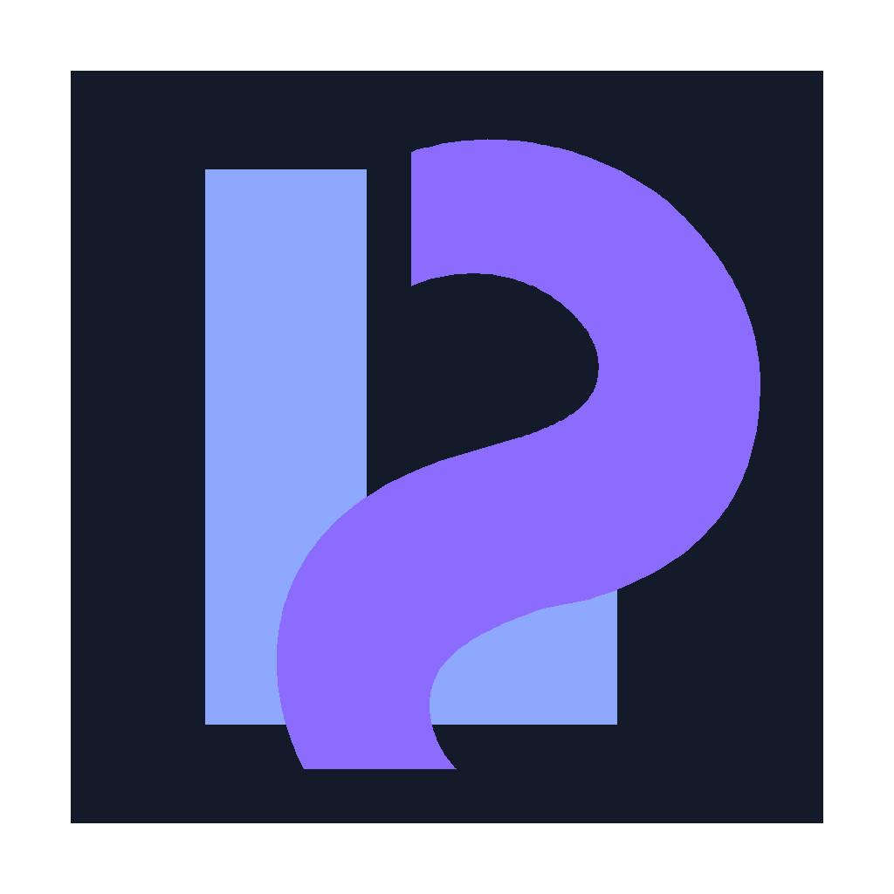
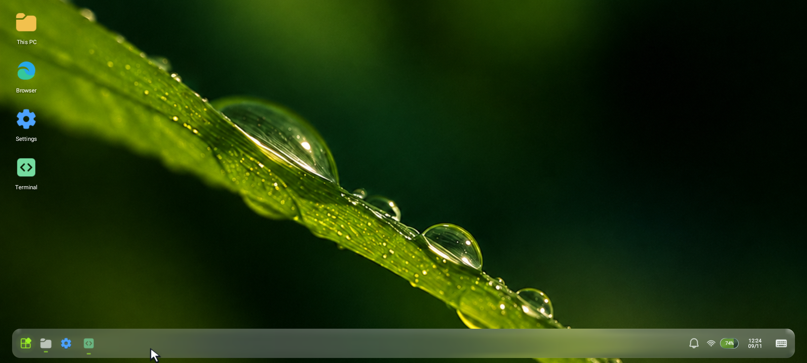
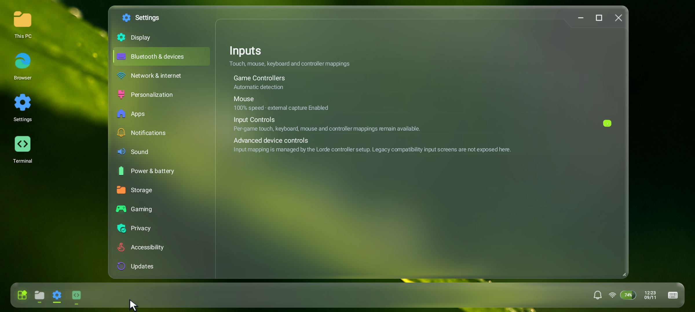
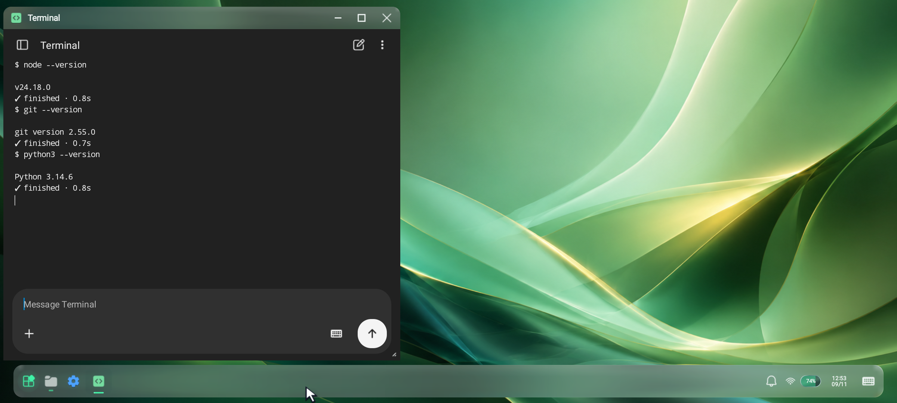
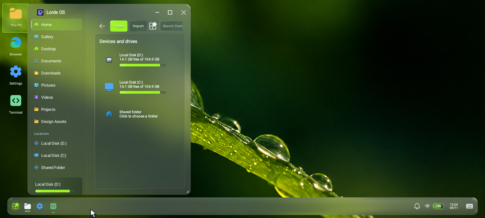
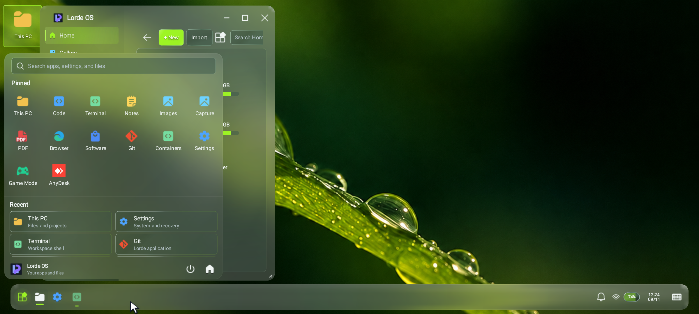

# Lorde OS

  

<h1 align="center">Lorde OS</h1>

  A device-powered Android workstation that runs Windows applications and a full rootless Linux userspace on your phone.

  
  
  

---

Lorde OS turns an Android device into a workstation. It hosts Windows applications through Wine with Box64 CPU translation, provides a rootless Linux userspace with a real terminal, and ships a native desktop shell with a taskbar, window manager, and launcher so all of it feels like one environment instead of a collection of apps.

Everything runs on the phone. No PC is required.

## Two builds

| Build | For | Requirements |
|---|---|---|
| **Lorde OS** (full) | The complete workstation: Windows containers, Linux userspace, terminal, developer tools, graphics stack | Android 7.1 or newer, arm64-v8a, about 1.2 GB free |
| **Lorde Companion** (light) | The lightweight surface for weaker devices: a WebView control surface and the local companion bridge, without the heavy Windows runtime payloads | Android 7.0 or newer, any CPU architecture, about 60 MB free |

If your device is a current flagship, install Lorde OS. If storage, memory or the CPU translation overhead is a concern, install Lorde Companion: it keeps the local companion bridge, the WebView-based control surface and device pairing, and leaves out the runtime that needs the headroom.

## Features

- **Windows applications on Android.** Wine with Box64 translation, DXVK and VKD3D graphics, Mesa Turnip and VirGL drivers, and per-container graphics profiles. Complex applications run without root: the app never asks for superuser rights and never modifies your system.
- **Frame generation and gaming tools.** GameScope-based Vulkan frame generation (GSFG), a floating GameBar overlay, a performance overlay, Android Game Mode integration and per-container graphics presets.
- **Rootless Linux userspace.** A verified Node.js 24 runtime with npm, Git, Python, pip, OpenSSH, ripgrep, proot and a full clang/LLVM toolchain, running inside the app without root. Every package is bundled in the APK and activated fully offline with SHA-256 verification.
- **A terminal that behaves.** Multiple tabs on a native PTY backend, a chat-style command surface with per-command status and timing, and honest reporting of the PTY backend and input state. Comfortable for long TUI-style sessions and agent CLIs.
- **Native desktop shell.** Taskbar, window management with minimize, maximize and snap-style controls, a launcher with per-application shortcuts, and a desktop that hosts native and Windows windows side by side.
- **Personalization.** Rotating wallpaper collections, accent themes that recolour the whole shell, light and dark glass surfaces, and system font selection.
- **Controls and input.** Per-game touch, keyboard, mouse and controller mappings, automatic game controller detection, external controller bindings and a trackpad pointer mode for precision work.
- **Files and storage.** A glass-surface file manager with home, gallery and disk locations, storage accounting per location and shared-folder access.
- **Browser.** An embedded browser surface for quick research without leaving the desktop.
- **Background persistence.** A foreground runtime service keeps Wine, terminal and development workloads alive while you switch apps; suspension is explicit sleep or a long idle period, never an arbitrary timer.
- **Settings that behave.** A single settings surface across display, personalization, apps, notifications, sound, power and battery, storage, gaming, privacy, accessibility, updates and about.
- **Update notifications.** The app can compare itself against the public releases on GitHub and tell you when a newer version has been published.

## Screenshots

## Download

The latest release is on the [GitHub Releases page](https://github.com/LordeStudios/LordeOS/releases/latest).

| Asset | Size | Notes |
|---|---|---|
| `LordeOS-1.0.1.apk` | see release page | Full workstation, arm64-v8a, Android 7.1 or newer |
| `LordeCompanion-1.0.1.apk` | see release page | Lightweight build for weaker devices, any CPU architecture, Android 7.0 or newer |
| `SHA256SUMS.txt` | small | SHA-256 checksums for both APKs |

Both APKs are signed with the Lorde Studios release key. Verify the download against the checksums before installing.

## Installation

1. Download the APK for your device from the [releases page](https://github.com/LordeStudios/LordeOS/releases/latest).
2. Verify it against `SHA256SUMS.txt`.
3. Allow installation from your file manager or browser when Android asks. Sideloading outside the Play Store is expected for this distribution.
4. Open the APK and install it.

Upgrading replaces the previous build in place, and your containers and settings are preserved as long as the signing key matches.

The first launch provisions the verified runtime payloads, which needs about 1.2 GB of free space and a few minutes on a fast connection.

## System requirements

- Android 7.1 (API 25) or newer for the full build, Android 7.0 (API 24) or newer for the companion build.
- arm64-v8a CPU for the full build. 32-bit-only devices are not supported by the full build; the companion build has no native libraries and runs on any ABI.
- 8 GB RAM or more for the full build, 2 GB for the companion build.
- About 1.2 GB of free storage for the full build, 60 MB for the companion build.

## Compatibility

- Windows applications: x86_64 binaries run through Wine with Box64. 32-bit Windows applications need the corresponding container preset.
- Linux userspace: arm64 packages from the verified runtime bundle.
- Graphics: DXVK for Vulkan titles, VKD3D for Direct3D 12, Mesa Turnip and VirGL for OpenGL and Vulkan.
- Remote desktop sessions work through the AnyDesk surface once the device is paired.

## Roadmap

- **Signed with a recognized publisher key.** The current builds are signed with the Lorde Studios release key, which sideloading devices treat as an unknown publisher. A long term publisher certificate would remove the remaining Play Protect notice.
- **Faster provisioning.** The first launch currently downloads and verifies roughly 1 GB of runtime payloads.
- **Complete acceptance for long running workflows.** Render and save round trips inside Windows applications, heavy game benchmarks, final link routing inside Wine, recovery flows and the embedded browser routing are still being verified on physical hardware.

## Release history

See the [releases page](https://github.com/LordeStudios/LordeOS/releases) for versioned downloads and notes. Changes are tracked in [`CHANGELOG.md`](CHANGELOG.md).

## Security

If you discover a vulnerability, please use [GitHub's private vulnerability reporting](https://github.com/LordeStudios/LordeOS/security/advisories/new) rather than a public issue. Do not include credentials, pairing tokens or working exploit details in public posts.

Lorde OS runs application containers and a rootless Linux userspace on your device. Keep pairing codes private, review what you install into a container, and do not run sensitive workflows unattended on a shared or untrusted device.

## Support

- Questions and help: the [issue tracker](https://github.com/LordeStudios/LordeOS/issues) (please search before opening a new issue).
- Bug reports: [open an issue](https://github.com/LordeStudios/LordeOS/issues/new) with the Lorde OS version, Android version, device model and whether you installed the full or companion build.
- Product site: [studios.lordemaximus.com](https://studios.lordemaximus.com)

## Publisher

**Lorde Studios.** Official organization: [github.com/lordestudios](https://github.com/lordestudios).

Lorde OS is proprietary software. This repository distributes builds and documentation only; the implementation source is not public.

### Third party components

Lorde OS builds on the open source Winlator project (GPL-3.0) and includes Wine (LGPL), Box64 and Box86 (zlib), Mesa (MIT), DXVK (zlib), VKD3D (MIT), Termux GLIBC patches (GPL-3.0), Node.js (MIT) and the Android platform-tools from Google (Apache-2.0). Their licences and notices travel with the application.
